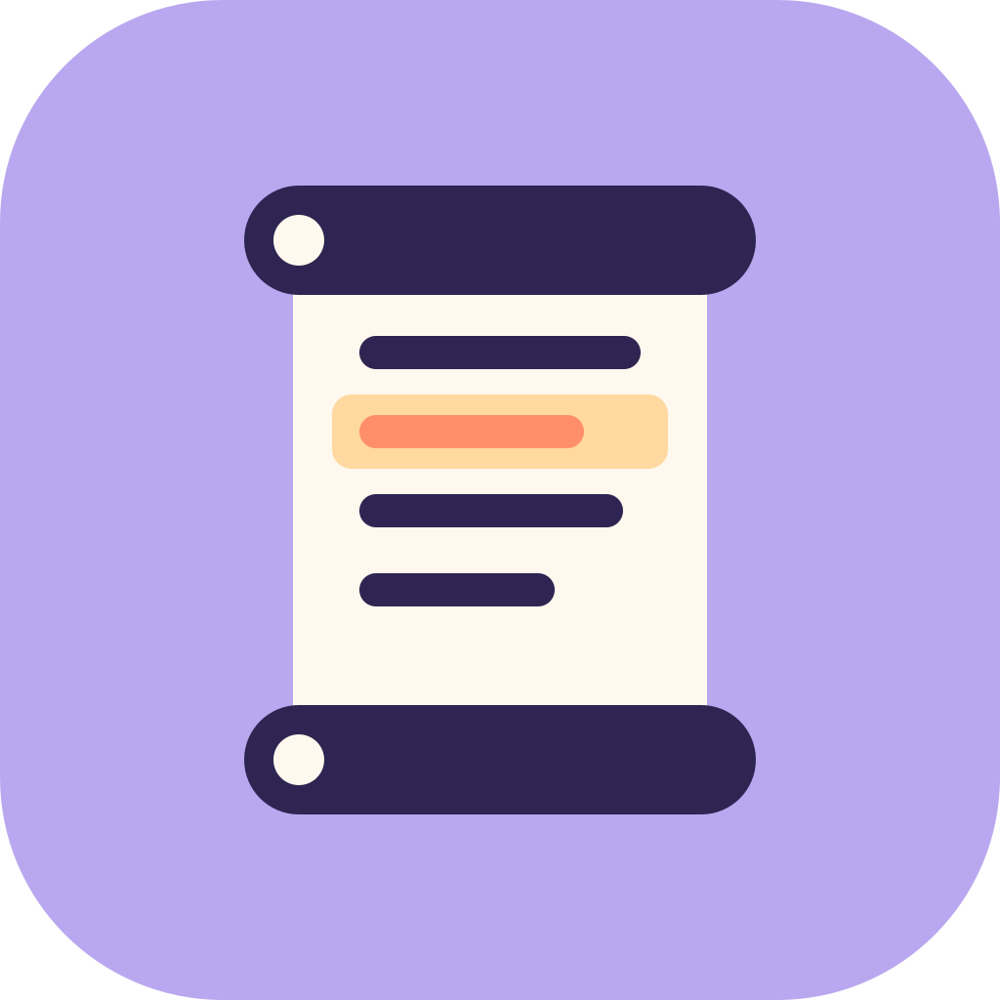

<p align="center">
  
</p>

<h1 align="center">GoodScroll</h1>

<p align="center"><em>One click, one line. Your mouse wheel, finally well-behaved.</em></p>

---

Somewhere along the way, macOS decided your mouse wheel was a trackpad in disguise. Nudge it once and the
page glides off like a greased otter. GoodScroll is a tiny menu bar friend that politely disagrees.

Every notch of the wheel scrolls exactly the number of lines you asked for, no more and no less. Your trackpad
keeps its swooshy, momentum-y, natural-scrolling magic, completely untouched. Everybody wins.

## What it does

- 📜 **One notch, N lines.** Pick how many lines a click of the wheel moves (3 is a lovely default). No acceleration, no surprises.
- 🔀 **Each device gets its own direction.** Natural on the trackpad, traditional on the mouse? Sure.
  macOS ties the two together with a single checkbox. GoodScroll unties them.
- 🪶 **Hands off your trackpad.** Speed, acceleration and momentum on the trackpad are never touched. At most, GoodScroll flips its direction, and only if you ask.
- 🎚️ **A secret smooth mode.** Hold ⌥, ⌃ or ⌘ (your choice) to get the old glide back for a moment.
- 🫥 **Stays out of the way.** It lives in the menu bar: no Dock icon, and it can launch at login. Universal binary, macOS 13+.

## Settings

Click the little scroll in your menu bar, or open **Settings…** for the full menu.

| Setting | What it does |
|---|---|
| Enable GoodScroll | The big switch. Off means every scroll passes straight through. |
| Discrete scrolling | Wheel notches become a fixed line count. Turn it off to keep macOS acceleration on the mouse and fix only the direction. |
| Lines per notch | 1 to 20 (default 3). |
| Discrete horizontal scrolling | Applies the same rule to tilt wheels and Shift-scroll. |
| Mouse direction | Follow System, Natural or Traditional. |
| Trackpad direction | Follow System, Natural or Traditional. Changes the direction only; feel and momentum stay as they are. |
| Smooth scroll while holding | Hold ⌥, ⌃ or ⌘ to get the original accelerated scroll for a moment. |
| Launch at login | Starts GoodScroll when you log in. It appears under System Settings → General → Login Items. |
| Show menu bar icon | Hides the scroll. To get Settings back, open GoodScroll again from Finder or Spotlight. |

## Install

1. Grab the zip from [Releases](https://github.com/vladjdk/goodscroll/releases).
2. Unzip it and drop `GoodScroll.app` into `/Applications`.
3. The app isn't notarized, so the first time you open it, right-click it and choose **Open**. Or run:
   ```sh
   xattr -dr com.apple.quarantine /Applications/GoodScroll.app
   ```
4. When asked, grant permission in System Settings → Privacy & Security → **Device Control and Data Access**
   (called **Accessibility** on older macOS). GoodScroll starts working the moment you flip the switch; no relaunch needed.

**Still asking for permission after you switched it on?** macOS is remembering an older build. Select
GoodScroll, remove it with **−**, then add `/Applications/GoodScroll.app` back with **+**.

### Build it yourself

You need Xcode or the Command Line Tools (Swift 5.9+).

```sh
make test      # run the unit tests
make install   # build a universal GoodScroll.app, copy it to /Applications and launch it
```

> **Heads up:** every local build is a "new app" as far as macOS is concerned, because ad-hoc signatures
> change each time. After rebuilding, remove and re-add GoodScroll under Device Control and Data Access.
> To skip this, set `SIGN_IDENTITY="Developer ID Application: …"` so every build is signed with the same identity.

To regenerate the app icon after changing the artwork, run `swift scripts/render-icon.swift`.

## How the magic works

GoodScroll watches scroll events as they go by and gently edits each one:

- **Mouse wheels** send chunky, *non-continuous* events. In discrete mode GoodScroll keeps only which way
  you scrolled and rewrites the amount to exactly ±N lines. When only the direction needs changing, it flips
  the line, fixed-point and pixel deltas together, so the scroll distance stays exactly the same.
- **Trackpads and Magic Mouse** send silky, *continuous* events. Those are only ever flipped, and only when
  your trackpad direction differs from the system setting.
- GoodScroll reads the system's "Natural scrolling" value directly and notices the moment you change it.

The decision logic lives in `GoodScrollCore` (plain Swift, unit tested). The event plumbing and the menus live in `GoodScroll`.

## Little quirks

- Magic Mouse sends continuous events, so it follows the **trackpad** direction setting.
- Some mouse software (for example Logi Options+) adds its own "smooth scrolling". That makes the mouse
  look like a trackpad to macOS, so GoodScroll leaves it alone. Turn that option off and the clicks come back.

## Brand

The logo is a paper scroll with one highlighted line: the line a single click moves you.
Lavender `#B9A8F0`, paper `#FFF8EE`, ink `#2E2552`, coral `#FF8F6B`, apricot `#FFD9A0`.
The wordmark is set in Fredoka, with DM Sans for body text. Artwork lives in [`assets/`](assets).

## License

MIT. Scroll freely.
